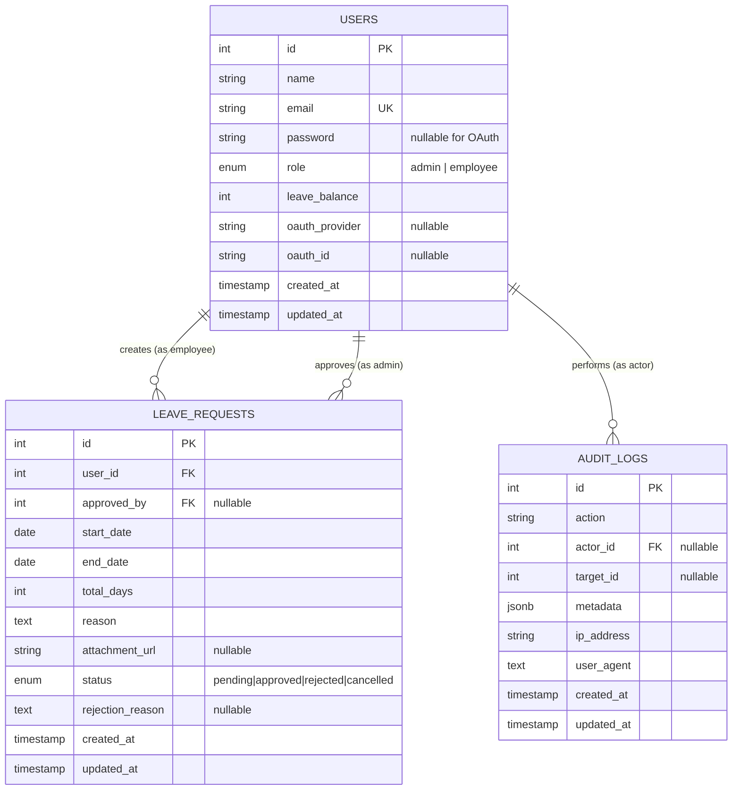

# 🏖️ Leave Management API

Backend REST API untuk sistem manajemen cuti karyawan, dibangun dengan **AdonisJS v5** + **TypeScript** + **PostgreSQL**.

---

## 📑 Table of Contents

1. [Project Overview](#1-project-overview)
2. [Tech Stack](#2-tech-stack)
3. [Architecture Overview](#3-architecture-overview)
4. [Database Schema Overview](#4-database-schema-overview)
5. [Installation Guide](#5-installation-guide)
6. [Environment Variables](#6-environment-variables)
7. [Migration Guide](#7-migration-guide)
8. [Seeder Guide](#8-seeder-guide)
9. [Authentication Flow](#9-authentication-flow)
10. [OAuth Flow](#10-oauth-flow)
11. [Leave Request Workflow](#11-leave-request-workflow)
12. [Running Tests](#12-running-tests)
13. [Swagger Documentation](#13-swagger-documentation)
14. [Postman Documentation](#14-postman-documentation)
15. [Sample Accounts](#15-sample-accounts)

---

## 1. Project Overview

**Leave Management API** adalah sistem backend untuk mengelola cuti karyawan dengan dua role utama:

- **Employee** — dapat membuat, melihat, dan membatalkan request cuti sendiri.
- **Admin** — dapat melihat semua request cuti serta melakukan approve/reject.

API menyediakan dua mekanisme autentikasi:
- **Conventional** (email + password)
- **OAuth Google** (via Adonis Ally)

Setiap request cuti **wajib** melampirkan attachment (PDF/PNG/JPG/JPEG, max 5MB) yang disimpan ke filesystem melalui Adonis Drive.

**Tech Stack Highlights:**
- TypeScript dengan strict type checking
- Clean / Layered Architecture (Controller → Service → Repository → Model)
- JWT untuk session management
- Repository pattern untuk abstraksi data access
- Dependency Injection via `@adonisjs/fold`

---

## 2. Tech Stack

| Layer | Technology |
|---|---|
| Framework | AdonisJS v5 |
| Language | TypeScript |
| Database | PostgreSQL 14+ |
| ORM | Lucid ORM v18 |
| Authentication | JWT + Adonis Ally (Google OAuth) |
| File Storage | Adonis Drive (local disk) |
| Testing | Japa |
| Validation | Adonis Validator |
| API Docs | Swagger UI |

---

## 3. Architecture Overview

Proyek menggunakan **Clean / Layered Architecture** dengan pemisahan tanggung jawab yang jelas. Setiap layer hanya bergantung pada layer di bawahnya.

### Layered Architecture

```
┌─────────────────────────────────────────┐
│   Controller  (HTTP request handler)    │
└──────────────────┬──────────────────────┘
                   ▼
┌─────────────────────────────────────────┐
│   Service      (Business logic)         │
└──────────────────┬──────────────────────┘
                   ▼
┌─────────────────────────────────────────┐
│   Repository   (Data access abstraction)│
└──────────────────┬──────────────────────┘
                   ▼
┌─────────────────────────────────────────┐
│   Model        (Lucid ORM entity)       │
└──────────────────┬──────────────────────┘
                   ▼
            PostgreSQL DB
```

### Request Flow

```
┌──────────────────────────────────────────────────────────────┐
│                    HTTP Request                               │
└──────────────────────────────────────────────────────────────┘
                            │
                            ▼
┌──────────────────────────────────────────────────────────────┐
│  Middleware:                                                │
│    • RateLimiter (rate limit)                               │
│    • JwtAuth   (verify JWT)                                  │
│    • Role      (employee / admin)                            │
└──────────────────────────────────────────────────────────────┘
                            │
                            ▼
┌──────────────────────────────────────────────────────────────┐
│  Controllers (app/Controllers/Http)                          │
│  → HTTP request/response handling                            │
│  → Validasi input via Validators                             │
│  → Panggil Service untuk business logic                      │
│  → Format response                                           │
└──────────────────────────────────────────────────────────────┘
                            │
                            ▼
┌──────────────────────────────────────────────────────────────┐
│  Services (app/Services)                                     │
│  → Business logic                                            │
│  → Orchestrate repository calls                              │
│  → Throw domain exceptions                                   │
│  → Log audit events                                          │
└──────────────────────────────────────────────────────────────┘
                            │
                            ▼
┌──────────────────────────────────────────────────────────────┐
│  Repositories (app/Repositories/Lucid)                       │
│  → Abstraksi data access                                     │
│  → Query building & transaction handling                     │
│  → Implementasi interface di Contracts/                      │
└──────────────────────────────────────────────────────────────┘
                            │
                            ▼
┌──────────────────────────────────────────────────────────────┐
│  Models (app/Models)                                         │
│  → Lucid ORM entities                                        │
│  → Relasi (hasMany, belongsTo)                               │
│  → Decorator-based column mapping                            │
└──────────────────────────────────────────────────────────────┘
                            │
                            ▼
                   ┌─────────────────┐
                   │  PostgreSQL DB  │
                   └─────────────────┘
```

### Authentication Flow (JWT)

```
┌────────┐
│ Client │
└───┬────┘
    │ ① POST /api/v1/auth/login { email, password }
    ▼
┌──────────────────┐
│ AuthController   │
└───┬──────────────┘
    │ ② validate → AuthService.login()
    ▼
┌──────────────────┐
│ AuthService      │
│  - findByEmail() │
│  - Hash.verify() │
│  - jwt.sign()    │
└───┬──────────────┘
    │ ③ JWT token (7-day expiry)
    ▼
┌────────┐
│ Client │  (token disimpan di client)
└───┬────┘
    │ ④ GET /api/v1/leaves  Authorization: Bearer <token>
    ▼
┌──────────────────┐
│ JwtAuth          │  ⑤ verify token → decode → fetch user
│ Middleware       │
└───┬──────────────┘
    │ ⑥ ctx.user attached
    ▼
┌──────────────────┐
│ Controller       │  ⑦ business logic
└──────────────────┘
```

### Leave Approval Flow

```
┌────────────┐
│  Employee  │
└─────┬──────┘
      │ ① POST /api/v1/leaves (multipart: start, end, reason, attachment)
      ▼
┌─────────────────┐
│ LeaveController │  ② validate, moveToDisk
└─────┬───────────┘
      │ ③
      ▼
┌─────────────────┐
│ LeaveService    │  ④ create → status: pending
└─────┬───────────┘
      │ ⑤ audit log: LEAVE_CREATED
      ▼
   ┌────────┐
   │PENDING │
   └───┬────┘
       │
       │ ⑥ PATCH /approve  (admin)
       │    PATCH /reject   (admin, +reason)
       │    PATCH /cancel   (employee)
       ▼
┌─────────────────┐
│ LeaveService    │  ⑦ status change + audit log
└─────┬───────────┘
      │
      ├──→ APPROVED   (balance deducted)
      ├──→ REJECTED   (rejection_reason saved)
      └──→ CANCELLED

   All transitions logged to audit_logs
```

### Entity Relationship Diagram (ERD)



### Dependency Injection

Services dan Repositories di-inject melalui `@adonisjs/fold`. Contoh:

```typescript
@inject([
  'App/Repositories/Contracts/LeaveRequestRepository',
  'App/Repositories/Contracts/UserRepository',
  'App/Services/AuditLogService',
])
export default class LeaveService {
  constructor (
    private leaveRequestRepository: LeaveRequestRepository,
    private userRepository: UserRepository,
    private auditLogService: AuditLogService
  ) {}
}
```

### Dependency Injection

Services dan Repositories di-inject melalui `@adonisjs/fold`. Contoh:

```typescript
@inject([
  'App/Repositories/Contracts/LeaveRequestRepository',
  'App/Repositories/Contracts/UserRepository',
  'App/Services/AuditLogService',
])
export default class LeaveService {
  constructor (
    private leaveRequestRepository: LeaveRequestRepository,
    private userRepository: UserRepository,
    private auditLogService: AuditLogService
  ) {}
}
```

---

---

## 4. Database Schema Overview

### `users` table

| Column | Type | Constraint | Description |
|---|---|---|---|
| id | SERIAL | PRIMARY KEY | |
| name | VARCHAR(255) | NOT NULL | |
| email | VARCHAR(255) | NOT NULL, UNIQUE | |
| password | VARCHAR(180) | NULLABLE | Nullable untuk OAuth-only users |
| role | ENUM | NOT NULL | `admin` \| `employee` |
| leave_balance | INTEGER | NOT NULL, DEFAULT 12 | |
| oauth_provider | VARCHAR(50) | NULLABLE | |
| oauth_id | VARCHAR(255) | NULLABLE | |
| created_at | TIMESTAMPTZ | | |
| updated_at | TIMESTAMPTZ | | |

**Composite unique:** `(oauth_provider, oauth_id)`

### `leave_requests` table

| Column | Type | Constraint | Description |
|---|---|---|---|
| id | SERIAL | PRIMARY KEY | |
| user_id | INTEGER | FK → users.id, ON DELETE CASCADE | Employee yang request |
| approved_by | INTEGER | FK → users.id, ON DELETE SET NULL | Admin yang proses |
| start_date | DATE | NOT NULL | |
| end_date | DATE | NOT NULL | |
| total_days | INTEGER | NOT NULL | end_date - start_date + 1 |
| reason | TEXT | NOT NULL | |
| attachment_url | VARCHAR(255) | NULLABLE | Path relatif: `leaves/<filename>` |
| status | ENUM | NOT NULL, DEFAULT pending | `pending` \| `approved` \| `rejected` \| `cancelled` |
| rejection_reason | TEXT | NULLABLE | |
| created_at | TIMESTAMPTZ | | |
| updated_at | TIMESTAMPTZ | | |

### `audit_logs` table

| Column | Type | Description |
|---|---|---|
| id | SERIAL | PRIMARY KEY |
| action | VARCHAR(100) | LOGIN, OAUTH_LOGIN, OAUTH_REGISTER, OAUTH_ACCOUNT_LINKED, LEAVE_CREATED, LEAVE_APPROVED, LEAVE_REJECTED, LEAVE_CANCELLED |
| actor_id | INTEGER | User yang melakukan aksi (FK → users.id) |
| target_id | INTEGER | Resource yang terdampak (mis. leave_request.id) |
| metadata | JSONB | Context tambahan (email, totalDays, dll) |
| ip_address | VARCHAR(45) | |
| user_agent | TEXT | |
| created_at | TIMESTAMPTZ | |
| updated_at | TIMESTAMPTZ | |

### ER Diagram (singkat)

```
users (1) ──< (N) leave_requests [as employee]
users (1) ──< (N) leave_requests [as approver]
users (1) ──< (N) audit_logs   [as actor]
```

---

## 5. Installation Guide

### Prerequisites

- Node.js >= 18.x
- PostgreSQL >= 14.x
- npm >= 8.x

### Step-by-step

```bash
# 1. Clone repository
git clone <repo-url>
cd leave-management-api

# 2. Install dependencies
npm install

# 3. Copy environment template
cp .env.example .env

# 4. Edit .env — sesuaikan DB credentials & OAuth (lihat bagian Environment Variables)

# 5. Buat database
psql postgres -c "CREATE USER leave_admin WITH PASSWORD 'secret123';"
psql postgres -c "CREATE DATABASE leave_management_db OWNER leave_admin;"

# 6. Run migrations
node ace migration:run

# 7. (Opsional) Seed admin account
node ace db:seed

# 8. Start development server
npm run dev
```

Server berjalan di: `http://localhost:3333`

---

## 6. Environment Variables

| Variable | Required | Default | Description |
|---|---|---|---|
| `HOST` | Yes | `0.0.0.0` | Server bind host |
| `PORT` | Yes | `3333` | Server port |
| `NODE_ENV` | Yes | `development` | `development` \| `production` \| `test` |
| `APP_KEY` | Yes | — | Encryption key (generate via `node ace generate:key`) |
| `JWT_SECRET` | Yes | — | Secret untuk signing JWT token |
| `APP_NAME` | No | — | App name |
| `DRIVE_DISK` | Yes | `local` | Disk driver untuk file upload |
| `DB_CONNECTION` | Yes | `pg` | DB driver |
| `PG_HOST` | Yes | `127.0.0.1` | PostgreSQL host |
| `PG_PORT` | No | `5432` | PostgreSQL port |
| `PG_USER` | Yes | — | PostgreSQL user |
| `PG_PASSWORD` | No | — | PostgreSQL password |
| `PG_DB_NAME` | Yes | — | PostgreSQL database name |
| `GOOGLE_CLIENT_ID` | No* | — | Google OAuth client ID |
| `GOOGLE_CLIENT_SECRET` | No* | — | Google OAuth client secret |
| `GOOGLE_CALLBACK_URL` | No* | — | `http://localhost:3333/api/v1/auth/google/callback` |

*Required untuk enable Google OAuth. Tanpa variabel ini, route OAuth akan return error saat dipanggil.

---

## 7. Migration Guide

Semua migration ada di `database/migrations/`. Dijalankan via Ace CLI:

```bash
# Run semua migration yang belum dijalankan
node ace migration:run

# Rollback batch terakhir
node ace migration:rollback

# Cek status migration
node ace migration:status
```

### Migration list:

1. `users` — Tabel users dengan OAuth columns
2. `leave_requests` — Tabel leave_requests dengan FK ke users
3. `add_composite_index_to_leave_requests` — Composite index untuk performance
4. `audit_logs` — Tabel audit_logs untuk tracking aksi

### Fresh install (drop & re-create):

```bash
node ace migration:rollback --batch=0
node ace migration:run
```

---

## 8. Seeder Guide

### Admin Seeder

`database/seeders/AdminSeeder.ts` membuat akun admin default untuk reviewer testing.

```bash
node ace db:seed
```

Seeder **idempotent** — skip jika `admin@example.com` sudah ada.

To run specific seeder:

```bash
node ace db:seed --files=database/seeders/AdminSeeder.ts
```

---

## 9. Authentication Flow

### Conventional (email + password)

```
┌────────┐                ┌────────────┐                ┌──────┐
│ Client │ ──POST /login─→│ Controller │ ──verify─────→ │ User │
│        │                │            │ ←─────hash──── │      │
│        │ ←─JWT + user── │            │                │      │
│        │                │ ──log────→ │ audit_logs     │      │
└────────┘                └────────────┘                └──────┘
```

**Flow:**

1. Client `POST /api/v1/auth/register` → user baru dibuat (password di-hash via `Hash.make`).
2. Client `POST /api/v1/auth/login` dengan email & password.
3. Service cek user exists, verify password via `Hash.verify`.
4. Service generate JWT (7-day expiry) via `jsonwebtoken`.
5. Audit log: `LOGIN` action dicatat dengan IP & User-Agent.

### JWT Middleware

`JwtAuth` middleware memvalidasi `Authorization: Bearer <token>` header. Token di-decode, user di-fetch dari DB, lalu dilampirkan ke `ctx.user` untuk handler downstream.

---

## 10. OAuth Flow

Implementasi menggunakan **Adonis Ally** untuk integrasi Google OAuth.

### Endpoints

- `GET /api/v1/auth/google/redirect` — Mengembalikan `redirectUrl` ke Google.
- `GET /api/v1/auth/google/callback` — Handle callback setelah user authorize.

### Flow

```
┌──────┐  ①  ┌───────────┐  ②  ┌─────────┐  ③  ┌──────────┐
│Client│────→│/redirect  │────→│ Google  │────→│ /callback│
│      │ ←───│ (get URL) │ ←───│ Login   │ ←───│          │
└──────┘     └───────────┘     └─────────┘     └─────┬────┘
                                                      │ ④
                                                      ▼
                                          ┌──────────────────────┐
                                          │ AuthService          │
                                          │  .handleOAuthLogin() │
                                          └──────┬───────────────┘
                                                 │
                       ┌─────────────────────────┼─────────────────────────┐
                       ▼                         ▼                         ▼
              ┌─────────────┐          ┌──────────────┐         ┌──────────────┐
              │ OAuth creds │          │ Email match  │         │ New email    │
              │  exist      │          │  → LINK      │         │  → CREATE    │
              │  → LOGIN    │          │  existing    │         │  employee    │
              └─────────────┘          └──────────────┘         └──────────────┘
```

### Business rules (di `AuthService.handleOAuthLogin`):

| Kondisi | Aksi | Audit log |
|---|---|---|
| `oauthProvider + oauthId` sudah ada di DB | Login existing OAuth user | `OAUTH_LOGIN` |
| Email match existing user, OAuth belum ter-link | Link OAuth ke existing user | `OAUTH_ACCOUNT_LINKED` |
| Email belum ada di DB | Buat employee baru (password null) | `OAUTH_REGISTER` |

### Setup Google OAuth credentials:

1. Buka [Google Cloud Console](https://console.cloud.google.com/) → buat OAuth 2.0 Client ID.
2. Set Authorized redirect URI: `http://localhost:3333/api/v1/auth/google/callback`
3. Copy Client ID & Client Secret ke `.env`:
   ```ini
   GOOGLE_CLIENT_ID=xxx.apps.googleusercontent.com
   GOOGLE_CLIENT_SECRET=xxx
   GOOGLE_CALLBACK_URL=http://localhost:3333/api/v1/auth/google/callback
   ```

---

## 11. Leave Request Workflow

```
                   ┌────────────┐
                   │  Employee  │
                   └─────┬──────┘
                         │ ① POST /leaves
                         │   (with attachment)
                         ▼
              ┌─────────────────────┐
              │      PENDING        │
              └────────┬────────────┘
                       │
        ┌──────────────┼──────────────┬────────────────┐
        │ ② PATCH      │ ③ PATCH      │ ④ PATCH        │
        │  /cancel     │  /approve    │  /reject       │
        │  (employee)  │  (admin)     │  (admin)       │
        ▼              ▼              ▼                │
┌──────────────┐ ┌──────────────┐ ┌──────────────┐    │
│  CANCELLED   │ │  APPROVED    │ │  REJECTED    │    │
└──────────────┘ └──────┬───────┘ └──────────────┘    │
                       │                              │
                       │ Auto-deduct                   │
                       │ leave_balance                │
                       │ = balance - total_days        │
                       ▼                              ▼
              (employee leave_balance)
              decremented
```

### Business rules

**Create leave (Employee):**
- `attachment` required (PDF/PNG/JPG/JPEG, max 5MB)
- `start_date <= end_date`
- `total_days <= user.leave_balance`
- Tidak boleh overlap dengan pending/approved request

**Cancel leave (Employee):**
- Hanya bisa cancel request sendiri
- Hanya leave yang masih `pending`
- Status → `cancelled`

**Approve leave (Admin):**
- Hanya admin
- Hanya leave `pending`
- Tidak boleh approve request sendiri
- `leave_balance` employee di-decrement dalam transaction

**Reject leave (Admin):**
- Hanya admin
- Hanya leave `pending`
- Tidak boleh reject request sendiri
- `rejection_reason` required

---

## 12. Running Tests

```bash
# Run semua test
npm run test

# Run specific suite
node ace test unit
node ace test functional

# Run specific test
node ace test --tests="approve leave request"

# Lint
npm run lint
npm run lint:fix
```

### Test structure

```
tests/
├── bootstrap.ts                 ← Japa config
├── unit/
│   └── services.spec.ts         ← Unit test untuk Service layer
└── functional/
    ├── auth.spec.ts             ← Integration test auth flow
    ├── leave.spec.ts            ← Integration test leave workflow
    └── docs.spec.ts             ← Swagger UI accessibility
```

Test database di-truncate sebelum setiap test group untuk isolation.

---

## 13. Swagger Documentation

API spec tersedia di:

- **JSON:** `http://localhost:3333/api/v1/swagger.json`
- **UI:** `http://localhost:3333/api/v1/docs`

File spec ada di `swagger.json` di root project.

```bash
# Akses UI di browser
open http://localhost:3333/api/v1/docs
```

---

## 14. Postman Documentation

Postman Collection tersedia di folder [`postman/`](./postman/):

| File | Deskripsi |
|---|---|
| `postman/leave-management-api.postman_collection.json` | Postman v2.1 collection (generated from `swagger.json`) |
| `postman/leave-management-api.local.postman_environment.json` | Local environment (`baseUrl`, `token`) |
| `postman/README.md` | Cara import & regenerate |

### Import cepat

1. Buka Postman → **Import** → drag & drop kedua JSON file di atas
2. Pilih environment **Leave Management API - Local**
3. Run **POST /auth/login** → copy `data.token` → set env var `token`
4. Endpoint protected lain sudah pakai `Bearer {{token}}`

### Published documentation URL

> ⚠️ **Tidak di-host otomatis** (butuh Postman API key + workspace).
> Untuk publish manual: import collection di Postman → klik **Publish Documentation** (book icon di sidebar) → copy URL dan taruh di sini.

```
https://documenter.getpostman.com/view/<your-uid>/leave-management-api
```

Lihat [`postman/README.md`](./postman/README.md) untuk langkah detail.

---

## 15. Sample Accounts

### Admin (via seeder)

| Field | Value |
|---|---|
| Email | `admin@example.com` |
| Password | `admin123` |
| Role | `admin` |
| Leave Balance | `12` |

Dibuat oleh `node ace db:seed`. Untuk membuat employee tambahan, gunakan `POST /api/v1/auth/register`.

### Employee (manual register)

| Field | Example |
|---|---|
| Email | `jane@example.com` |
| Password | `password123` (min 6 chars) |
| Role | `employee` (auto-assigned) |
| Leave Balance | `12` (default) |

### Login sebagai admin:

```bash
curl -X POST http://localhost:3333/api/v1/auth/login \
  -H "Content-Type: application/json" \
  -d '{"email":"admin@example.com","password":"admin123"}'
```

Response:
```json
{
  "success": true,
  "message": "Login successful",
  "data": {
    "user": { "id": 1, "name": "Admin", "email": "admin@example.com", "role": "admin", "leave_balance": 12 },
    "token": "eyJhbGciOiJIUzI1NiIs..."
  }
}
```

Gunakan `data.token` sebagai `Authorization: Bearer <token>` di endpoint protected.

---

## Project Structure

```
leave-management-api/
├── app/
│   ├── Controllers/Http/    ← HTTP request handlers
│   │   ├── AuthController.ts
│   │   ├── OAuthController.ts
│   │   ├── LeaveController.ts
│   │   └── ApprovalController.ts
│   ├── Exceptions/          ← Global error handler
│   ├── Middleware/          ← JwtAuth, Role, RateLimiter
│   ├── Models/              ← User, LeaveRequest, AuditLog
│   ├── Repositories/        ← Data access abstraction
│   │   ├── Contracts/       ← Repository interfaces
│   │   └── Lucid/           ← Repository implementations
│   ├── Services/            ← Business logic
│   │   ├── AuthService.ts
│   │   ├── LeaveService.ts
│   │   └── AuditLogService.ts
│   ├── Validators/          ← Request validation schemas
│   └── Enums/               ← Role, LeaveStatus
├── config/                  ← Framework config
├── contracts/               ← TS type augmentations
├── database/
│   ├── migrations/          ← DB schema
│   └── seeders/             ← AdminSeeder
├── providers/               ← IoC bindings
├── start/
│   ├── kernel.ts            ← Middleware registration
│   └── routes.ts            ← API routes
├── swagger.json             ← OpenAPI spec
├── tests/
│   ├── functional/
│   └── unit/
└── tmp/uploads/leaves/      ← Attachment storage
```

---

## Available Scripts

```bash
npm run dev          # Start dev server (hot reload)
npm run build        # Build production bundle
npm start            # Run production build
npm test             # Run all tests
npm run lint         # ESLint check
npm run lint:fix     # Auto-fix lint
npm run format       # Prettier format
npm run typecheck    # tsc --noEmit
```

---

## Useful Ace Commands

```bash
# Generate files
node ace make:controller LeaveRequest --resource
node ace make:model LeaveRequest -m
node ace make:migration create_leave_requests_table
node ace make:validator CreateLeaveRequest

# Database
node ace migration:run
node ace migration:rollback
node ace migration:status
node ace db:seed

# Debug
node ace list:routes
node ace repl
```

---

## License

MIT
