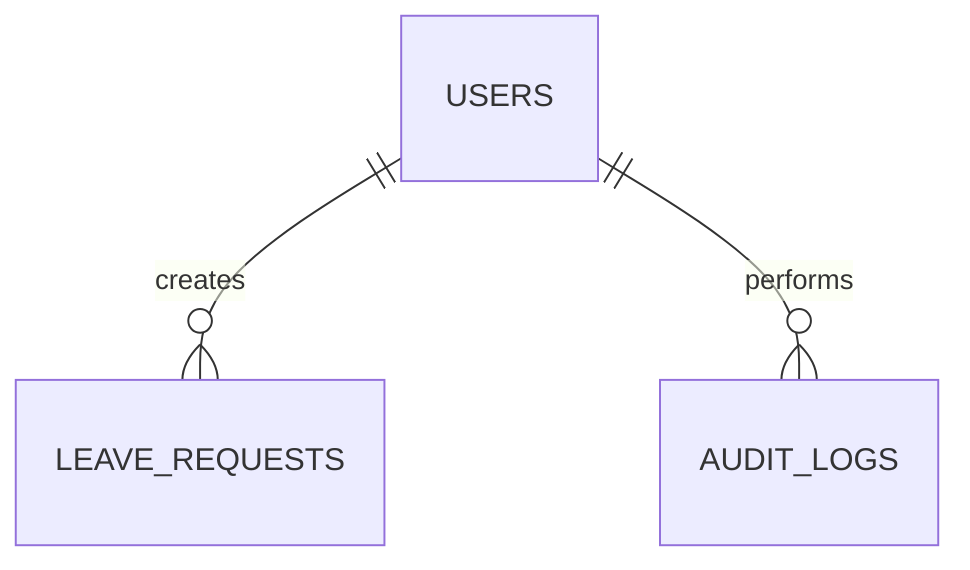

# Issue #7 — Architecture & System Design Documentation

## Background

Technical test meminta penjelasan arsitektur sistem.

Saat ini README menjelaskan setup tetapi belum menjelaskan arsitektur secara visual.

## Objective

Menambahkan dokumentasi arsitektur yang menjelaskan:

- Layered/Clean Architecture
- Request flow
- Database design
- Authentication flow
- Leave approval workflow

## Acceptance Criteria

README memiliki section:

### Architecture

```
Controller
↓
Service
↓
Repository
↓
Model
↓
PostgreSQL
```

### Authentication Flow

```
Login
↓
JWT Generate
↓
Protected Endpoint
↓
JwtAuth Middleware
```

### Leave Approval Flow

```
Employee Submit
↓
Pending
↓
Admin Approve / Reject
↓
Audit Log Created
```

### ERD

Tambahkan Mermaid Diagram:



## Deliverable

README lebih profesional dan mudah dipahami reviewer.
